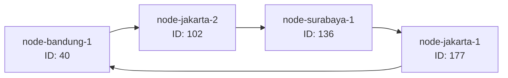
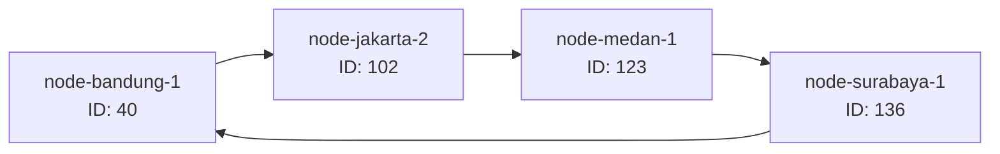

# Tugas 6 (Pekan 6) — Penamaan & Resolusi Lokasi

**Materi terkait:** Flat Naming, Structured Naming (DNS), Distributed Hash Table (DHT)/Chord.

## Studi Kasus

Pelanggan FoodGo kesulitan menemukan alamat IP server kurir yang **dinamis** (kurir berpindah lokasi/jaringan, IP-nya sering berubah). FoodGo butuh cara memetakan **ID Kurir** (identitas tetap) ke **alamat IP terkininya** tanpa server pusat tunggal yang jadi bottleneck/single point of failure.

## Tugas Kelompok

Implementasikan **simulasi Chord DHT** sederhana (single-process, tidak perlu jaringan sungguhan — cukup simulasi struktur data & algoritma di satu program Python) yang memetakan ID Kurir ke alamat IP mereka.

Konsep yang harus terlihat jalan dalam simulasi kalian:
1. **Consistent hashing**: ID Kurir dan ID Node di-hash ke ruang angka yang sama (mis. 0–255 untuk kesederhanaan, `m=8` bit).
2. **Ring topology**: node-node diurutkan melingkar berdasarkan hasil hash-nya.
3. **Lookup**: fungsi `lookup(kurir_id)` yang menemukan node mana yang bertanggung jawab menyimpan mapping ID Kurir tersebut → alamat IP-nya (aturan Chord: node dengan ID hash **terkecil yang lebih besar atau sama dengan** hash key, disebut *successor*).
4. **Perubahan topologi**: simulasikan minimal satu node baru bergabung (`join`) atau satu node keluar (`leave`), tunjukkan bagaimana mapping berpindah tanggung jawab ke node lain.

Skeleton disediakan di `src/chord_simulation.py` dengan fungsi hashing dan struktur ring sudah ada — bagian `lookup()`, `join()`, dan `leave()` sengaja dikosongkan.

### Cara Menjalankan

```bash
python3 src/chord_simulation.py
```

## Tugas Analisis (`README.md`)

1. Jelaskan **kenapa DHT/Chord** lebih cocok untuk kasus ini dibanding **flat naming sederhana** (mis. tabel pusat ID→IP) atau **DNS konvensional** — kaitkan dengan sifat "IP kurir sering berubah" dan kebutuhan tanpa titik gagal tunggal.
**Jawab:** 
Pada studi kasus FoodGo, alamat IP kurir bersifat dinamis karena kurir dapat berpindah lokasi atau jaringan sehingga alamat IP yang digunakan dapat berubah. Oleh karena itu, FoodGo membutuhkan mekanisme untuk memetakan ID Kurir sebagai identitas tetap ke alamat IP terkininya tanpa bergantung pada satu server pusat.

**Flat Naming sederhana** menggunakan tabel pemetaan ID ke IP yang dapat disimpan pada satu server pusat. Pendekatan ini mudah diterapkan, tetapi memiliki kelemahan karena seluruh proses pencarian bergantung pada server tersebut. Jika server mengalami gangguan, proses pencarian alamat IP dapat ikut terganggu. Server pusat juga berpotensi menjadi bottleneck ketika jumlah permintaan meningkat.

**DNS konvensional** digunakan untuk menerjemahkan nama domain menjadi alamat IP. DNS mendukung pembaruan informasi alamat melalui pengelolaan record dan TTL, tetapi tidak secara langsung menyediakan mekanisme pembagian tanggung jawab data antarnode berdasarkan consistent hashing seperti Chord. Perubahan alamat IP juga perlu memperhatikan proses pembaruan dan cache DNS.

**Chord DHT (Distributed Hash Table)** menggunakan consistent hashing untuk memetakan ID node dan ID kurir ke ruang identifier yang sama. Setiap data menjadi tanggung jawab node successor, yaitu node dengan ID terkecil yang lebih besar atau sama dengan hash data. Jika tidak ditemukan node yang memenuhi kondisi tersebut, pencarian kembali ke node dengan ID terkecil melalui mekanisme *wrap-around*.

Ketika node bergabung atau keluar, pembagian tanggung jawab data dapat dihitung kembali berdasarkan susunan ring. Dengan demikian, FoodGo tidak harus bergantung pada satu server pusat untuk melakukan pencarian mapping ID Kurir ke alamat IP.

Berdasarkan perbandingan tersebut, Chord DHT lebih sesuai untuk kebutuhan FoodGo karena mendukung pembagian tanggung jawab data secara terdistribusi dan perubahan keanggotaan node. Namun, simulasi ini belum menerapkan replikasi data maupun mekanisme pemulihan kegagalan secara penuh. 

2. Gambarkan (boleh pakai Mermaid, lihat Tugas 2) ring topology dari simulasi kalian, tandai node mana yang bertanggung jawab atas ID Kurir mana.
**Jawab:** Simulasi Chord menggunakan ruang identifier 8 bit dengan rentang 0–255. ID node dan ID kurir dihasilkan menggunakan fungsi hashing SHA-1 yang hasilnya dimodulo dengan 256.

### A. Ring Topology Awal

Berdasarkan hasil hashing dari program, empat node awal memiliki ID sebagai berikut:

| Node | Hash ID | Alamat IP |
|---|---:|---|
| node-bandung-1 | 40 | 10.0.0.3 |
| node-jakarta-2 | 102 | 10.0.0.2 |
| node-surabaya-1 | 136 | 10.0.0.4 |
| node-jakarta-1 | 177 | 10.0.0.1 |

Urutan node dalam ring ditentukan berdasarkan nilai hash dari yang terkecil hingga terbesar. Setelah mencapai ID terbesar, ring kembali ke node dengan ID terkecil.

Berikut gambaran ring topology awal:



### B. Mapping ID Kurir

Berdasarkan hasil hashing dan proses registrasi pada program, diperoleh mapping sebagai berikut:

| ID Kurir | Hash Kurir | Node Penanggung Jawab | IP Kurir |
|---|---:|---|---|
| kurir-001 | 50 | node-jakarta-2 (102) | 192.168.1.10 |
| kurir-002 | 28 | node-bandung-1 (40) | 192.168.1.11 |
| kurir-003 | 132 | node-surabaya-1 (136) | 192.168.1.12 |

Node penanggung jawab ditentukan menggunakan fungsi `find_successor()`. Setiap ID kurir diarahkan ke node dengan hash terkecil yang lebih besar atau sama dengan hash kurir tersebut. Jika tidak ditemukan, pencarian kembali ke node dengan hash terkecil.

Alamat IP kurir merupakan informasi yang disimpan, sedangkan alamat IP node merupakan alamat server yang bertanggung jawab atas data kurir.

### C. Penelusuran Manual Proses Lookup

Sebagai contoh, dilakukan penelusuran proses `lookup()` untuk ID Kurir `kurir-001`.

1. Program menerima ID Kurir `kurir-001`.
2. Fungsi `hash_id()` menghitung hash ID kurir menggunakan SHA-1 modulo 256 dan menghasilkan nilai **50**.
3. Program memeriksa urutan ID node yang tersedia, yaitu 40, 102, 136, dan 177.
4. Program mencari node dengan ID terkecil yang lebih besar atau sama dengan 50.
5. Node dengan ID 40 tidak memenuhi kondisi karena nilainya lebih kecil dari 50.
6. Node dengan ID 102 memenuhi kondisi karena merupakan ID terkecil yang lebih besar atau sama dengan 50.
7. Dengan demikian, successor untuk hash 50 adalah `node-jakarta-2` dengan ID 102.
8. Program mengambil data kurir dari `self.data` berdasarkan hash 50 dan memperoleh alamat IP `192.168.1.10`.

Hasil lookup:

```text
--- Lookup sebelum perubahan topologi ---
kurir-001 -> 192.168.1.10
```

Dengan demikian, proses lookup berhasil menemukan alamat IP kurir berdasarkan ID kurir melalui node yang bertanggung jawab pada ring.

3. Jelaskan apa yang terjadi pada mapping saat sebuah node **keluar** dari ring (siapa yang mengambil alih tanggung jawabnya) — dukung dengan output program.
**Jawab:** Pada simulasi FoodGo, perubahan topologi dilakukan melalui proses `join()` dan `leave()`. Kedua proses tersebut menunjukkan bagaimana pembagian tanggung jawab data berubah ketika terdapat node baru yang bergabung atau node lama keluar dari ring.

### A. Proses Join (Node Baru Bergabung)

Pada proses join, node baru bernama `node-medan-1` dengan alamat IP `10.0.0.5` bergabung ke dalam ring.

Berdasarkan hasil hashing, node tersebut memperoleh ID 123. Sebelum node baru bergabung, successor untuk ID 123 adalah `node-surabaya-1` dengan ID 136.

Setelah `node-medan-1` bergabung, node tersebut menjadi successor untuk data dengan hash 123. Untuk membuktikan perpindahan tanggung jawab, program menggunakan data pengujian `kurir-uji-join-9` dengan hash 123.

Perubahan tanggung jawab yang terjadi:

- Sebelum join: `node-surabaya-1` (ID 136).
- Setelah join: `node-medan-1` (ID 123).
- Data yang berpindah: `kurir-uji-join-9` (hash 123).

Berdasarkan output program:

```text
--- Node baru bergabung ---
[TODO] Node 'node-medan-1' (id=123) bergabung, alamat 10.0.0.5
[TRANSFER] Data hash 123 berpindah dari node 136 ke node 123
[INFO] Successor lama node baru: 136
```

Hasil tersebut menunjukkan bahwa node baru mengambil alih tanggung jawab data yang sebelumnya berada pada successor lama.

### B. Proses Leave (Node Keluar)

Pada proses leave, node `node-jakarta-1` dengan ID 177 dikeluarkan dari ring.

Sebelum node dihapus, program memeriksa data yang menjadi tanggung jawab node tersebut. Untuk membuktikan perpindahan tanggung jawab, digunakan data pengujian `kurir-uji-leave-10` dengan hash 169.

Sebelum node keluar, hash 169 menjadi tanggung jawab `node-jakarta-1` dengan ID 177 karena node tersebut merupakan successor pertama yang memiliki ID lebih besar atau sama dengan 169.

Setelah `node-jakarta-1` keluar, pencarian successor untuk hash 169 melewati akhir ring dan kembali ke node dengan ID terkecil, yaitu `node-bandung-1` dengan ID 40. Proses ini disebut *wrap-around*.

Perubahan tanggung jawab yang terjadi:

- Sebelum leave: `node-jakarta-1` (ID 177).
- Setelah leave: `node-bandung-1` (ID 40).
- Data yang berpindah: `kurir-uji-leave-10` (hash 169).

Berdasarkan output program:

```text
--- Sebuah node keluar ---
[TRANSFER] Data hash 169 berpindah dari node 177 ke node 40
[TODO] Node 'node-jakarta-1' (id=177) keluar dari ring
```

Hasil tersebut menunjukkan bahwa `node-bandung-1` mengambil alih tanggung jawab data setelah `node-jakarta-1` keluar dari ring.

### C. Ring Topology Setelah Join dan Leave

Setelah `node-medan-1` bergabung dan `node-jakarta-1` keluar, susunan ring berubah menjadi empat node berikut:

| Node | Hash ID | Status |
|---|---:|---|
| node-bandung-1 | 40 | Tetap bergabung |
| node-jakarta-2 | 102 | Tetap bergabung |
| node-medan-1 | 123 | Node baru bergabung |
| node-surabaya-1 | 136 | Tetap bergabung |
| node-jakarta-1 | 177 | Keluar dari ring |

Berikut gambaran ring topology setelah perubahan:



### D. Analisis Hasil

Berdasarkan hasil pengujian, proses join dan leave menunjukkan bahwa perubahan keanggotaan node dapat mengubah pembagian tanggung jawab data pada ring Chord.

Ketika `node-medan-1` bergabung, data dengan hash 123 yang sebelumnya menjadi tanggung jawab `node-surabaya-1` berpindah ke node baru tersebut.

Ketika `node-jakarta-1` keluar, data dengan hash 169 yang sebelumnya menjadi tanggung jawab node tersebut dialihkan ke `node-bandung-1` melalui mekanisme *wrap-around*.

Perubahan tersebut tidak menyebabkan alamat IP kurir ikut berubah. Yang berubah adalah node yang bertanggung jawab atas mapping ID kurir dan alamat IP-nya.

Hasil lookup setelah perubahan topologi juga menunjukkan bahwa alamat IP kurir yang telah didaftarkan masih dapat ditemukan:

| ID Kurir | Hasil Lookup |
|---|---|
| kurir-001 | 192.168.1.10 |
| kurir-002 | 192.168.1.11 |

Dengan demikian, simulasi menunjukkan bahwa Chord dapat menentukan kembali node penanggung jawab ketika terjadi perubahan topologi.

**Catatan implementasi:** Perpindahan tanggung jawab dalam program ini ditampilkan melalui log `[TRANSFER]`. Data kurir masih disimpan dalam satu dictionary global (`self.data`), sehingga pemindahan data fisik antarnode belum benar-benar dilakukan.

## Struktur Submission

```
tugas-06-penamaan-dht/
├── README.md      # Analisis + diagram ring
├── JURNAL.md
├── src/
│   └── chord_simulation.py
└── bukti/          # Output program (screenshot/log) untuk skenario join & leave
```

## Rubrik Penilaian (Tugas 6)

| Komponen | Bobot | Kriteria |
|---|---|---|
| Implementasi lookup/join/leave benar | 35% | Consistent hashing & successor lookup sesuai aturan Chord |
| Bukti perubahan topologi (join/leave) | 25% | Output menunjukkan mapping berpindah dengan benar |
| Analisis kenapa DHT vs flat naming/DNS | 25% | Argumen spesifik ke kasus IP kurir dinamis, bukan definisi umum |
| Proses & kontribusi kelompok | 15% | `JURNAL.md`, commit history |

## Batasan Penggunaan AI (Level 2)

Kebijakan **Level 2 (AI Assisted Idea Generation & Structuring)** berlaku — lihat [`../RUBRIK-UMUM.md`](../RUBRIK-UMUM.md). Boleh bertanya konsep umum consistent hashing/Chord ke AI; **tidak boleh** meminta AI menuliskan isi `# TODO` di `src/chord_simulation.py` (`find_successor`, `join`, `leave`, dst). Catat pemakaian AI di "Log Penggunaan AI" pada `JURNAL.md`.

- `README.md` wajib menelusuri manual (langkah demi langkah) bagaimana `lookup()` menemukan successor untuk salah satu ID Kurir contoh yang dipakai di `chord_simulation.py` — bukan cuma menempelkan output program.
