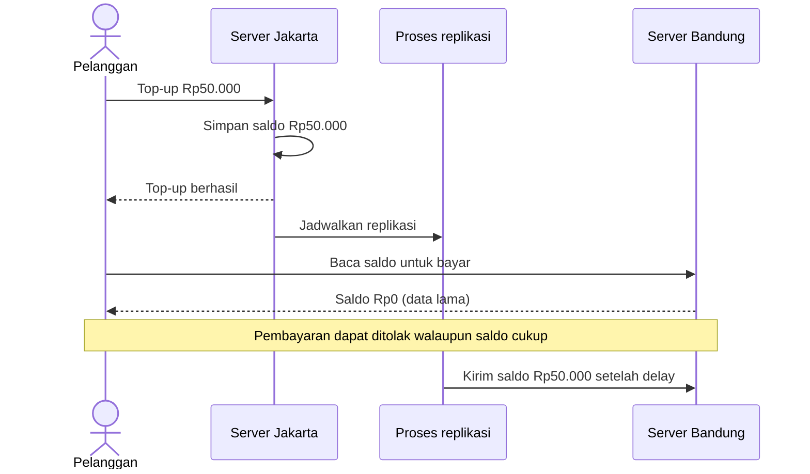
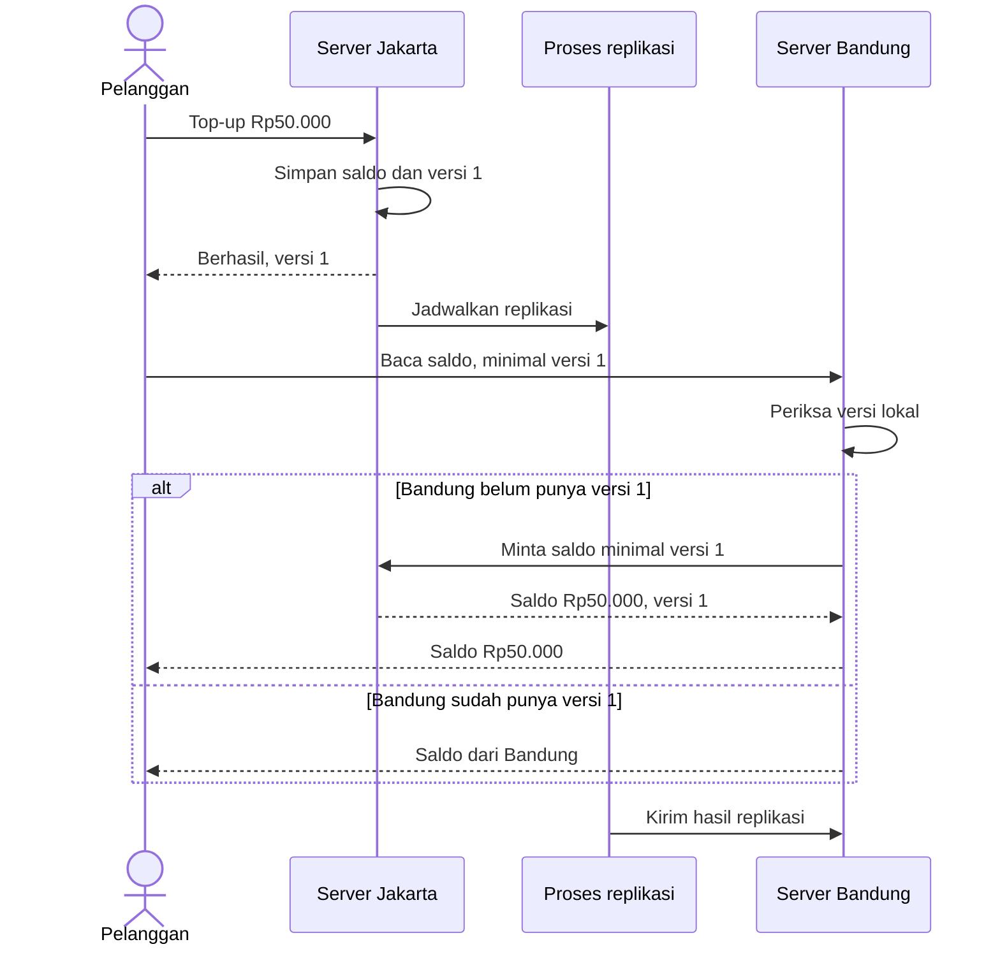

# Tugas 7 (Pekan 7) — Konsistensi Data

**Materi terkait:** Data-Centric Consistency (Sequential, Eventual), Client-Centric Consistency.

## Studi Kasus

Data saldo *e-wallet* pelanggan FoodGo berbeda antara server wilayah **Jakarta** dan **Bandung** karena replikasi antar server berjalan lambat. Contoh kasus nyata: pelanggan top-up saldo lewat server Jakarta, lalu dalam hitungan detik memesan makanan lewat aplikasi yang tersambung ke server Bandung — saldo belum ter-update, transaksi ditolak padahal saldo sebenarnya cukup.

## Tugas Kelompok

### Bagian 1 — Analisis (wajib)

1. Tentukan: apakah kasus ini **membutuhkan Sequential Consistency** (semua replika melihat urutan operasi yang sama) atau **cukup Eventual Consistency** (replika akan konsisten "pada akhirnya", boleh sementara berbeda)? Berikan argumen berbasis dampak bisnis (mis. kasus saldo *e-wallet* jauh lebih sensitif dibanding kasus "jumlah like" di media sosial).
2. Jika kalian menyimpulkan Eventual Consistency saja **tidak cukup** untuk skenario ini, usulkan pendekatan **Client-Centric Consistency** yang relevan (mis. *Read-Your-Writes*: pelanggan yang baru top-up harus selalu melihat saldo terbarunya sendiri, walau replika lain belum sinkron).
3. Gambarkan **diagram alir urutan (sequence diagram)** yang menunjukkan operasi read/write antara pelanggan, server Jakarta, server Bandung, dan proses replikasi — untuk skenario **tanpa** jaminan konsistensi (bug terjadi) DAN skenario **dengan** solusi yang kalian usulkan (bug teratasi). Pakai Mermaid (`sequenceDiagram`) di `README.md` — lihat contoh cara pakai di Tugas 2.

### Bagian 2 — Simulasi (opsional, nilai tambah)

Skeleton `src/replica_simulation.py` mensimulasikan dua replika (Jakarta & Bandung) dengan delay replikasi buatan. Lengkapi TODO untuk:
1. Menunjukkan kondisi **inconsistent read** (replika Bandung masih menunjukkan saldo lama walau Jakarta sudah update).
2. Mengimplementasikan mekanisme **Read-Your-Writes** sederhana (mis. dengan version/timestamp per client) yang memperbaiki masalah tersebut.

```bash
python3 src/replica_simulation.py
```

## Struktur Submission

```
tugas-07-konsistensi-data/
├── README.md      # Analisis konsistensi + sequence diagram Mermaid
├── JURNAL.md
├── src/            # (opsional) simulasi replikasi
└── bukti/          # (jika mengerjakan simulasi) output program
```

## Rubrik Penilaian (Tugas 7)

| Komponen | Bobot | Kriteria |
|---|---|---|
| Ketepatan pemilihan model konsistensi | 30% | Argumen berbasis dampak bisnis nyata, bukan hafalan definisi |
| Kualitas sequence diagram | 30% | Menunjukkan jelas titik kegagalan & titik perbaikan |
| Usulan solusi client-centric | 25% | Solusi konkret dan dapat diimplementasikan (bukan wacana abstrak) |
| Proses & kontribusi kelompok | 15% | `JURNAL.md`, commit history (+ bonus jika simulasi dikerjakan) |

## Batasan Penggunaan AI (Level 2)

Kebijakan **Level 2 (AI Assisted Idea Generation & Structuring)** berlaku — lihat [`../RUBRIK-UMUM.md`](../RUBRIK-UMUM.md). Boleh bertanya konsep umum consistency model ke AI untuk brainstorming; **tidak boleh** meminta AI menuliskan analisis akhir/sequence diagram atau isi `# TODO` di `src/replica_simulation.py` yang tinggal ditempel. Catat pemakaian AI di "Log Penggunaan AI" pada `JURNAL.md`.

- Sebagai bukti pemahaman konsep (bukan hafalan jawaban skenario FoodGo saja), `README.md` wajib menyertakan **satu skenario tambahan** yang kalian buat sendiri (mis. kasus lain di aplikasi ojek online) dan menentukan model konsistensi yang tepat untuk skenario tambahan tersebut.

## Analisis kasus FoodGo

Menurut kami, eventual consistency saja belum cukup untuk saldo e-wallet. Setelah pelanggan top-up di Jakarta, saldo di Bandung bisa masih lama selama replikasi berjalan. Akibatnya, pesanan yang seharusnya bisa dibayar malah ditolak. Hal ini bisa membuat pelanggan bingung dan kehilangan kepercayaan terhadap aplikasi. Kondisinya berbeda dengan jumlah like, yang biasanya masih bisa menerima keterlambatan pembaruan sebentar.

Kami memilih sequential consistency sebagai kebutuhan untuk pengurutan operasi saldo di seluruh replika. Namun, urutan yang sama saja tidak menjamin pembacaan selalu melihat penulisan terbaru menurut waktu nyata. Untuk kasus pelanggan yang baru top-up, kami juga membutuhkan read-your-writes agar pembacaan berikutnya oleh pelanggan tersebut tidak lebih lama daripada hasil top-up miliknya. Untuk transaksi pembayaran sebenarnya, operasi pengurangan saldo juga harus dilakukan secara atomik pada penyimpanan yang menjamin konsistensi kuat, agar dua pembayaran bersamaan tidak sama-sama menggunakan saldo yang sama.

### Usulan read-your-writes

Setelah top-up berhasil di Jakarta, server memberikan versi hasil penulisan kepada pelanggan. Saat pelanggan membaca saldo di Bandung, aplikasi ikut mengirim versi terakhir tersebut. Bandung membandingkan versinya dengan versi yang dibawa pelanggan. Jika Bandung sudah memiliki versi yang cukup baru, saldo dibaca dari Bandung. Jika belum, permintaan diarahkan ke Jakarta atau menunggu sampai replikasi selesai. Cara ini memerlukan penyimpanan versi di sisi pelanggan dan penanganan ketika Jakarta tidak tersedia. Jaminannya berlaku untuk penulisan pelanggan itu sendiri; mekanisme ini saja belum menyelesaikan semua konflik transaksi.

### Alur tanpa read-your-writes



### Alur dengan read-your-writes



### Skenario tambahan

Jumlah ulasan atau like pada restoran dapat menggunakan eventual consistency. Bila jumlah like di dua wilayah berbeda selama beberapa detik, pelanggan masih dapat menggunakan aplikasi dan tidak ada saldo yang berkurang. Setelah replikasi selesai, kedua wilayah akan menampilkan data yang sama. Sistem tetap perlu menangani pengiriman like berulang agar satu tindakan tidak terhitung lebih dari sekali.

## Hasil simulasi

Jalankan `python src/replica_simulation.py`. Pada skenario naif, pembacaan langsung di Bandung menghasilkan Rp0 setelah top-up Rp50.000 di Jakarta karena replikasi belum selesai. Pada skenario berikutnya, top-up Rp20.000 membuat saldo Jakarta menjadi Rp70.000. Bandung masih memiliki versi lama sehingga pembacaan dialihkan ke Jakarta dan menghasilkan Rp70.000. Bukti hasil tersedia di `bukti/hasil simulasi.png`.

Simulasi ini menunjukkan read-your-writes pada alur sederhana tersebut; simulasi belum membuktikan sequential consistency atau keamanan transaksi bersamaan.
