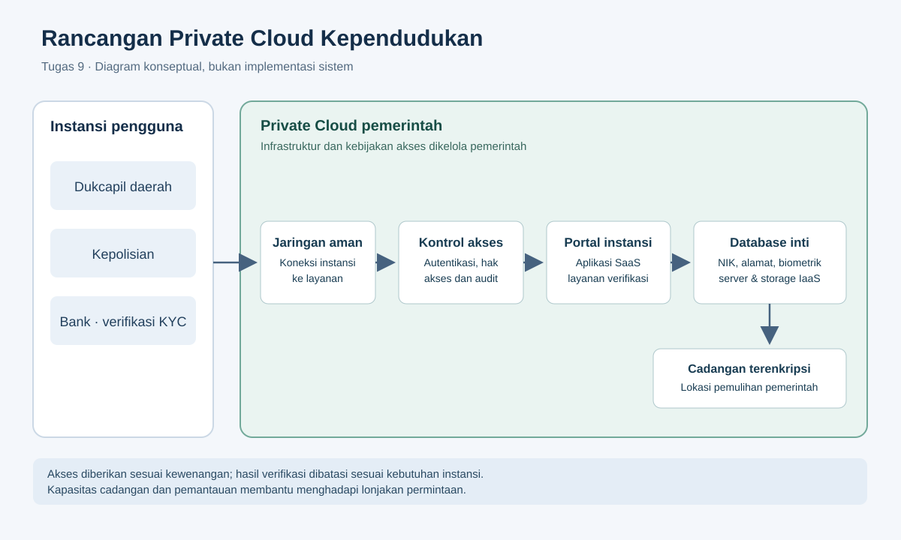

# Tugas 9 (Pekan 9) — Cloud Delivery & Deployment Model

**Materi terkait:** Karakteristik esensial cloud computing (NIST SP 800-145), Deployment Model (Public/Private/Hybrid/Community), Service Model (IaaS/PaaS/SaaS).

> Bagian 2 mata kuliah ini murni **analisis & desain di atas kertas** — tidak ada biaya cloud sama sekali, karena tugas berhenti di tahap rekomendasi, bukan implementasi nyata (implementasi baru mulai Tugas 11).

## Studi Kasus

Pemerintah ingin membangun **Sistem Data Kependudukan** (nama, NIK, alamat, data biometrik) yang:
- Sangat **rahasia** (data pribadi warga negara, diatur UU Perlindungan Data Pribadi).
- Diakses oleh **ribuan instansi** (dukcapil daerah, kepolisian, bank untuk verifikasi KYC) dengan pola akses yang **tidak rata** (lonjakan saat musim pemilu/pendaftaran sekolah).
- Butuh **skalabilitas** agar tidak downtime saat lonjakan akses, tapi **tidak boleh** datanya berada di infrastruktur yang tidak terkendali penuh oleh negara.

## Tugas Kelompok

1. **Rekomendasikan Deployment Model** (Public / Private / Hybrid / Community Cloud) yang paling tepat untuk sistem ini. Jelaskan alasannya berdasarkan **karakteristik NIST** (on-demand self-service, broad network access, resource pooling, rapid elasticity, measured service) dikaitkan dengan kebutuhan kerahasiaan vs skalabilitas.
2. **Rekomendasikan Service Model** (IaaS / PaaS / SaaS) yang tepat untuk komponen-komponen berbeda dari sistem ini (boleh berbeda service model untuk komponen berbeda, mis. database inti vs portal publik untuk pengecekan status).
3. Jelaskan **minimal 2 risiko spesifik** dari pilihan kalian dan mitigasinya (mis. jika Hybrid Cloud dipilih: risiko sinkronisasi data antara private & public segment).
4. Bandingkan singkat dengan **satu alternatif yang kalian tolak** — kenapa alternatif itu kurang tepat (mis. kenapa Public Cloud murni ditolak, atau kenapa Private Cloud murni dianggap kurang skalabel).

## Jawaban Tugas Kelompok
1. ### Rekomendasi Deployment Model
Deployment Model yang kami pilih adalah Private Cloud karena Sistem Data Kependudukan mengelola data pribadi yang sangat sensitif, seperti NIK, alamat, dan biometrik penduduk. Private Cloud memungkinkan infrastruktur dikhususkan untuk pemerintah sehingga pengelolaan data, server, jaringan, dan kebijakan keamanan berada dalam kendali pemerintah.

Pemilihan ini juga sesuai dengan lima karakteristik NIST. On-demand self-service memungkinkan instansi menggunakan sumber daya sesuai kebutuhan, sedangkan broad network access mendukung akses dari berbagai instansi melalui jaringan yang aman. Resource pooling memungkinkan penggunaan sumber daya secara bersama dan terpusat. Rapid elasticity mendukung penyesuaian kapasitas ketika terjadi lonjakan akses, sementara measured service memungkinkan penggunaan sumber daya dipantau dan diukur.

Dengan demikian, Private Cloud dapat memberikan kendali lebih besar terhadap keamanan data sekaligus mendukung kebutuhan akses dan skalabilitas sistem. Namun, pemerintah tetap perlu menyiapkan kapasitas infrastruktur yang memadai agar layanan tidak mengalami downtime saat terjadi lonjakan akses.

2. ### Rekomendasi Service Model
Service Model yang direkomendasikan adalah kombinasi IaaS dan SaaS. IaaS digunakan untuk database inti kependudukan karena pemerintah membutuhkan kendali terhadap server, penyimpanan, dan konfigurasi infrastruktur yang menyimpan data sensitif penduduk. Sementara itu, SaaS digunakan untuk portal akses instansi agar pengguna dapat memanfaatkan aplikasi yang telah disediakan tanpa harus mengelola infrastruktur di belakangnya.

Kombinasi kedua model ini memungkinkan pemerintah mempertahankan kendali terhadap infrastruktur penyimpanan data sekaligus menyediakan layanan yang mudah digunakan oleh berbagai instansi.


### 3. Risiko dan mitigasi

- **Kapasitas tidak cukup saat lonjakan akses.** Permintaan verifikasi NIK dari banyak instansi saat pendaftaran sekolah atau pemilu dapat memenuhi kapasitas private cloud sehingga layanan menjadi lambat atau tidak tersedia. Pemerintah perlu memperkirakan kebutuhan berdasarkan pola akses, melakukan uji beban, menyiapkan kapasitas cadangan, serta memantau penggunaan agar sumber daya bisa ditambah sebelum mencapai batas. Elastisitas tetap dibatasi kapasitas fisik yang tersedia.
- **Akses data oleh pihak yang tidak berwenang.** Akun instansi yang dicuri atau memiliki hak akses berlebihan dapat digunakan untuk melihat data penduduk, termasuk biometrik. Hak akses perlu dibatasi sesuai tugas dan kebutuhan masing-masing instansi, disertai autentikasi multifaktor, enkripsi data, serta pencatatan dan pemeriksaan akses. Misalnya, layanan verifikasi bank cukup mengembalikan hasil cocok atau tidak cocok sesuai kewenangannya, bukan seluruh data biometrik.
- **Gangguan pusat data.** Kerusakan perangkat atau bencana pada pusat data dapat menghentikan pelayanan dan mengancam ketersediaan data. Mitigasinya adalah menyiapkan cadangan terenkripsi dan lokasi pemulihan yang tetap berada dalam kendali pemerintah, serta menguji proses pemulihan secara berkala.

### 4. Perbandingan dengan Public Cloud

Public Cloud murni memiliki kelebihan karena kapasitas lebih mudah disesuaikan saat akses meningkat dan pemerintah tidak harus menyediakan seluruh perangkat sendiri. Namun, dalam kasus ini infrastruktur penyedia tidak berada dalam kendali penuh negara, sementara soal mensyaratkan data kependudukan tetap berada pada infrastruktur yang dikendalikan negara. Karena itu, kami memilih Private Cloud. Pilihan ini membawa tanggung jawab lebih besar untuk menyediakan kapasitas dan memelihara keamanan; penggunaan Private Cloud tidak otomatis membuat data aman.

### Skenario tandingan

Bagaimana jika dinas kependudukan di daerah tidak memiliki infrastruktur private cloud sendiri? Dinas tersebut tetap dapat mengakses layanan private cloud pemerintah yang dikelola secara terpusat melalui jaringan aman, tanpa harus membangun pusat data sendiri. Hak aksesnya dibatasi sesuai wilayah dan tugasnya. Jika jaringan ke pusat terputus, layanan yang membutuhkan akses langsung ke data pusat dapat tertunda; karena itu perlu koneksi cadangan dan prosedur pelayanan sementara yang tidak membuat salinan data sensitif tanpa pengamanan.

## Diagram rancangan

Diagram ini menggambarkan usulan alur akses dan penyimpanan, bukan bukti implementasi sistem.



## Anggota dan kontribusi

Kontribusi dicatat berdasarkan pekerjaan yang telah dilakukan; data NIM perlu dikonfirmasi kembali.

| Nama | NIM | Kontribusi Tugas 9 |
|---|---|---|
| Annisa Nur Shadrina | 103072400134 |  Penyusunan analisis risiko, perbandingan alternatif, dan skenario tandingan  |
| Alexandria Febrianti  | 103072400066 | Belum dikonfirmasi |
| Wahyu | 103072400006 | Menyusun rekomendasi deployment dan service model serta mencatat proses diskusi di jurnal. |

## Struktur Submission

```
tugas-09-cloud-delivery-deployment/
├── README.md      # Analisis lengkap (isi dengan poin 1-4 di atas)
├── JURNAL.md
└── bukti/          # (opsional) diagram pendukung
```

## Rubrik Penilaian (Tugas 9)

| Komponen | Bobot | Kriteria |
|---|---|---|
| Ketepatan rekomendasi deployment model | 30% | Argumen berbasis karakteristik NIST, bukan sekadar "private cloud lebih aman" tanpa detail |
| Ketepatan rekomendasi service model | 25% | Pemetaan komponen sistem ke IaaS/PaaS/SaaS masuk akal |
| Analisis risiko & mitigasi | 25% | Risiko spesifik ke konteks data kependudukan (bukan risiko generik) |
| Perbandingan dengan alternatif yang ditolak | 20% | Argumen penolakan jelas dan berdasar |

## Batasan Penggunaan AI (Level 2)

Kebijakan **Level 2 (AI Assisted Idea Generation & Structuring)** berlaku — lihat [`../RUBRIK-UMUM.md`](../RUBRIK-UMUM.md). Boleh bertanya ke AI gambaran umum karakteristik NIST/deployment model untuk brainstorming; **tidak boleh** meminta AI menuliskan rekomendasi/analisis akhir yang tinggal ditempel ke `README.md`. Catat pemakaian AI di "Log Penggunaan AI" pada `JURNAL.md`.


